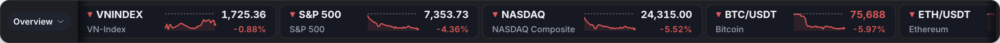
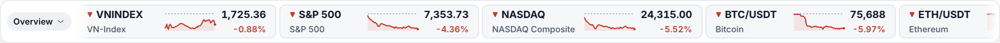
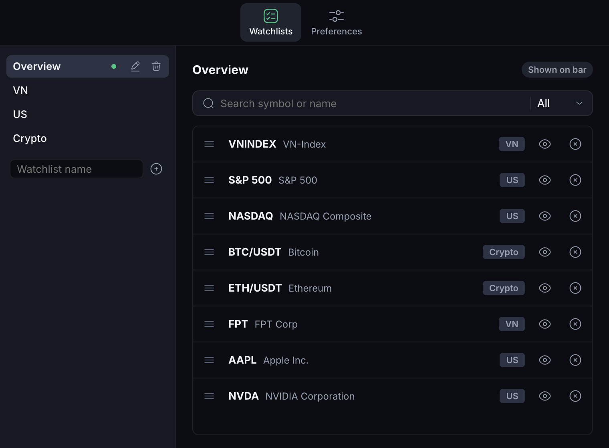
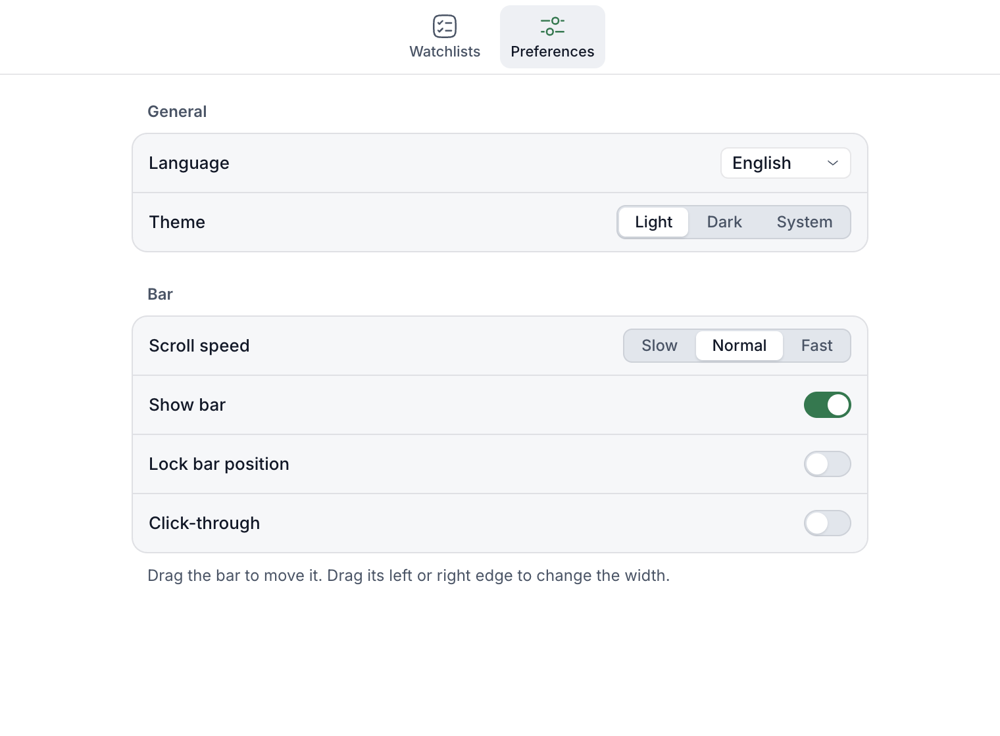

# TopTick

TopTick is a small desktop bar that scrolls live prices for Vietnamese stocks and indices, US stocks and indices, and crypto. The bar stays on top of other windows, so you can follow prices and indices while you work in other apps, without switching back to a price board in the browser.



## Features

- Always on top: the bar floats above your other windows.
- Each item shows a ▲/▼ glyph, the symbol and name, a sparkline with a dashed reference line, the last price and the percent change.
- Vietnamese stocks use the local board colors: yellow at the reference price, purple at the ceiling, cyan at the floor.
- More items than fit on the bar scroll sideways in a loop. Hovering pauses the scroll.
- Watchlists: add, reorder, hide and show symbols, and switch lists from the bar.
- Drag the bar to move it and drag its left or right edge to change its width. **Lock position** turns both off.
- Scrolling pauses while the bar is hidden. Prices keep updating.
- Light, Dark and System themes. English and Vietnamese UI.
- Tray / menu-bar icon with pause, lock, click-through and Settings.

## Screenshots



| Watchlists (dark theme) | Preferences (light theme) |
|---|---|
|  |  |

The screenshots show real data, captured after the US and Vietnamese markets had closed.

## Platforms

| Platform | Status |
|---|---|
| macOS, Apple silicon (arm64) | Built and tested |
| macOS, Intel (x64) | Builds; not tested on an Intel Mac |
| Windows x64 | Installer builds, but it has not been tested on Windows (see [Known limitations](#known-limitations)) |

## Install

Download the files for your system from the repository's **Releases** page, or build the app yourself (see [Development](#development)). The builds are not signed.

- **macOS:** open `TopTick-<version>-mac-arm64.dmg` (Apple silicon) or `TopTick-<version>-mac-x64.dmg` (Intel) and drag TopTick to Applications. A build you made yourself opens directly: macOS only adds the quarantine flag to files that were downloaded or received, so Gatekeeper does not check it.
  A copy you downloaded or got from another Mac is quarantined, and macOS blocks it because it is not signed or notarized. Since macOS 15, right-click → **Open** no longer gets past this. Try to open the app once, then go to **System Settings → Privacy & Security**, scroll to **Security**, click **Open Anyway** and confirm ([Apple's instructions](https://support.apple.com/en-us/102445)). If macOS says the app is damaged, remove the quarantine flag instead:
  `xattr -dr com.apple.quarantine /Applications/TopTick.app`
  TopTick has no Dock icon while only the bar is open; use the menu-bar icon.
- **Windows:** run `TopTick Setup <version>.exe`. If SmartScreen blocks it, click **More info → Run anyway**. The installer is per-user.

## Development

Requires Node.js 22 (22.12 or later) or Node.js 24, and npm. GitHub Actions uses Node.js 24.

```sh
npm install        # install dependencies (downloads Electron)
npm run dev        # run the app with hot reload
npm run check      # type-check, unit tests and end-to-end tests
npm run dist:mac   # unsigned macOS .dmg and .zip (arm64 and x64) in release/
npm run dist:win   # unsigned Windows NSIS installer in release/
```

Other scripts: `npm test` (unit tests only), `npm run compare-live` (prints current values from every data source next to the website to compare them with) and `npm run gen-icons` (regenerates the icons in `build/`).

### Environment variables

All of them are for development and testing. The app needs none of them.

| Variable | Purpose | Default |
|---|---|---|
| `TOPTICK_FAKE_DATA=1` | Offline mode: generated prices for every market and a static symbol list for search. | Off (real data) |
| `TOPTICK_VN_FORCE_FAIL=vietcap\|cafef\|all` | Makes the named Vietnamese data source fail, to show the switch to CafeF (`vietcap`) or the stale indicator (`all`). Also read by `npm run compare-live`. | Unset |
| `TOPTICK_USER_DATA_DIR=<dir>` | Stores settings, logs and cache in `<dir>` instead of the normal app-data folder. The end-to-end tests use it to isolate runs. | The OS app-data folder |
| `TOPTICK_LIVE=1` | Runs the live-data end-to-end test (`tests/e2e/live.spec.ts`), which is skipped otherwise. | Off |

Example: `TOPTICK_FAKE_DATA=1 npm run dev`. In PowerShell: `$env:TOPTICK_FAKE_DATA=1; npm run dev`.

## Releases

GitHub Actions (`.github/workflows/release.yml`) type-checks, runs the unit tests and builds the packages on every push to `main` and every pull request. Pushing a version tag also publishes a GitHub Release with the macOS arm64 and x64 `.dmg` and `.zip` files and the Windows x64 installer attached.

To cut a release, set `version` in `package.json`, commit and push, then tag that commit with the same version and push the tag:

```sh
git tag v0.1.0
git push origin v0.1.0
```

The workflow stops if the tag does not match `package.json`. The builds are unsigned, so macOS and Windows warn on first launch (see [Install](#install)).

## Data sources

| Market | Source | Updates |
|---|---|---|
| Vietnamese stocks and indices | Vietcap trading API (`trading.vietcap.com.vn`); CafeF (`banggia.cafef.vn`) as fallback | Every 3 s in session (Vietcap), every 10 s from CafeF, 60 s outside the session |
| Crypto | Binance WebSocket and REST (`api.binance.com`) | Every second |
| US stocks and indices | Yahoo Finance chart API (`query1.finance.yahoo.com`) | Every 10 s per symbol, regular session only |

These are free, public but unofficial endpoints. They can change or block access at any time. Crypto prices are USDT pairs, so they differ slightly from USD quotes. When a source stops answering during its session, items keep their last value and show a stale dot. The tooltip on each item shows the source and the time of the last update.

## Settings and logs

Settings are saved to `settings.json` in the app-data folder: `~/Library/Application Support/TopTick/` on macOS and `%APPDATA%\TopTick\` on Windows. The same folder holds `logs/main.log` and a `cache/` of symbol lists. If `settings.json` is invalid, it is renamed to `settings.corrupt-<timestamp>.json` and the app starts with defaults.

## Known limitations

- **Windows is untested.** The Windows installer builds, but it has never been run on Windows. Window behavior, drag and edge resize, the tray icon, theme following and the installer may not work there.
- **Unsigned builds.** There are no signed or notarized builds. A downloaded or copied macOS build is blocked until you allow it (see [Install](#install)). Windows SmartScreen may warn about the installer.
- **Unofficial data.** All data sources are unofficial and may change, lag or stop working. US prices cover the regular session only, without pre- or post-market.
- **Pause when not visible (macOS).** Scrolling pauses when the bar is hidden and when a much larger window from another app covers it. A window only slightly wider than the bar is not detected as covering it. Pausing on screen lock, sleep and user switching is wired up but has not been checked with real OS events. A display that sleeps without locking does not pause the scroll.
- **Resource use.** TopTick is an Electron app: about 250 MB on disk (the dmg is about 110 MB) and about 350–450 MB of memory across its processes.

## License

The code is released under the [MIT License](LICENSE).

- **Icons:** the app, tray and in-app icons come from the [Solar icon set](https://github.com/480-Design/Solar-Icon-Set) by 480 Design (via [Streamline](https://www.streamlinehq.com/)), licensed under [CC BY 4.0](https://creativecommons.org/licenses/by/4.0/). The app and tray icons are modified from Solar's "Graph Up". The MIT License does not cover them.
- **Market data** comes from third-party endpoints (Vietcap, CafeF, Yahoo Finance, Binance). It is not covered by the MIT License and belongs to its providers. It is for personal, informational use only and is not financial advice. Do not redistribute it.
